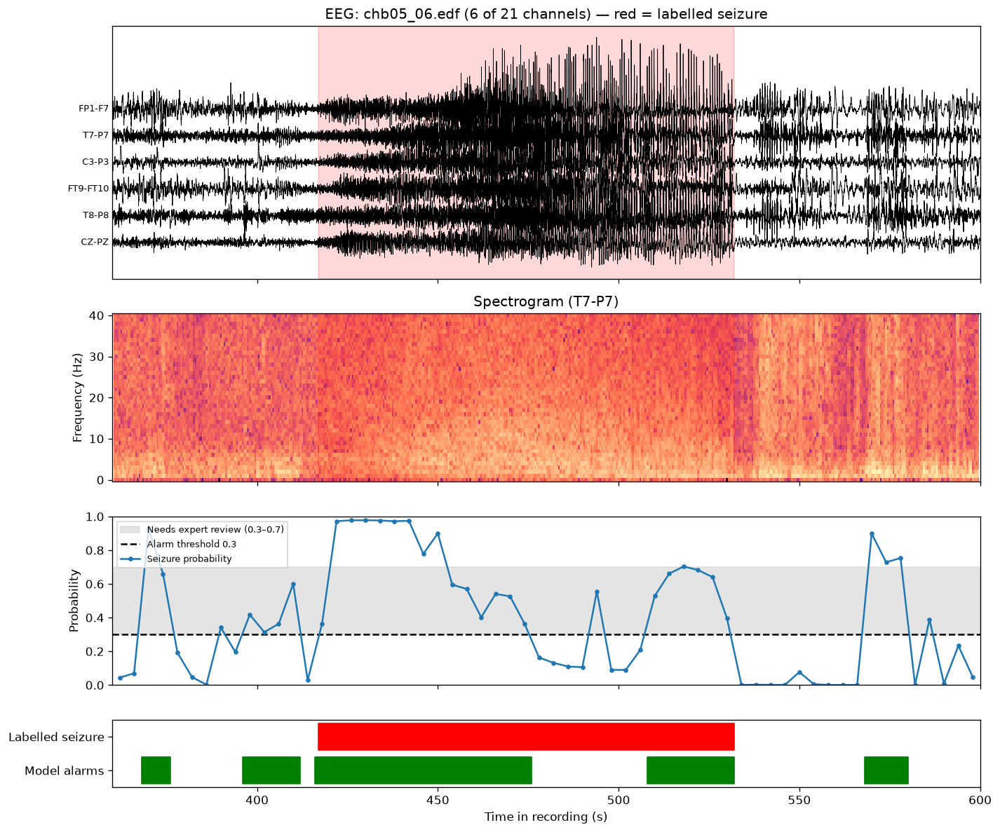
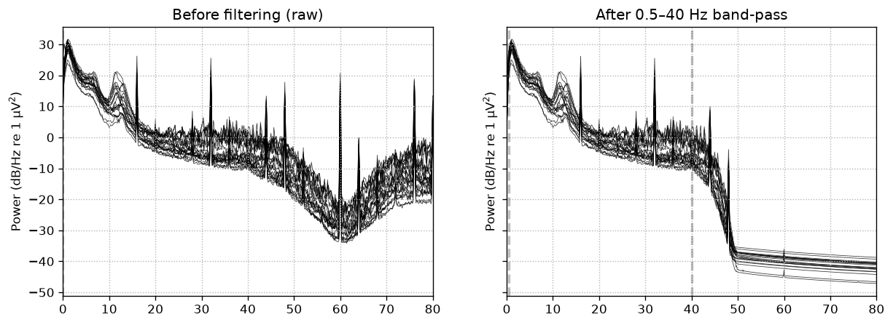
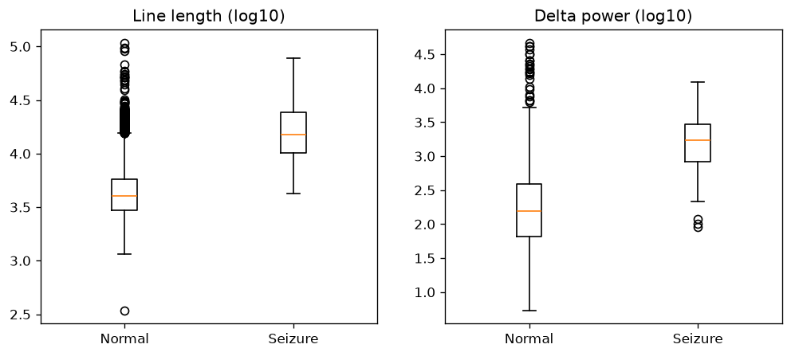
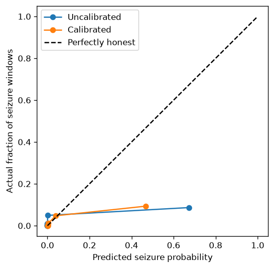
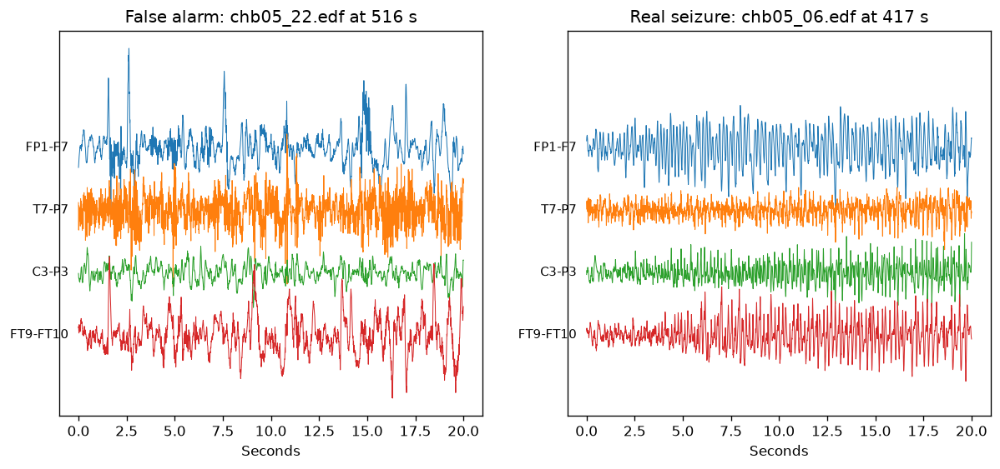
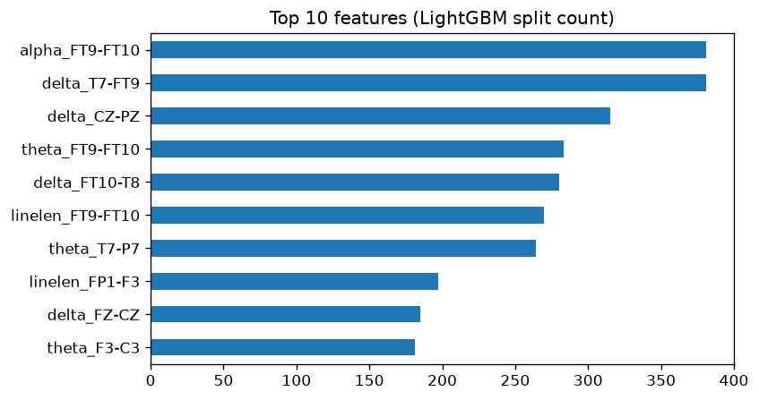

# NeuroSignal AI: Patient-Independent, Uncertainty-Aware EEG Seizure Detection

**AI Innovation Hackathon 2026, Track 2: Biomedical AI, Challenge 08 (NeuroSignal AI: EEG Seizure Event Detection)**

> Research prototype only. Not for clinical seizure diagnosis.

- **Live demo:** [http://localhost:8501]
- **Demo video:** [video link]
- **Team:** Shruti Chatterjee (individual participant)



---

## Selected problem statement

**Challenge 08, NeuroSignal AI: EEG Seizure Event Detection.** EEG signals contain complex temporal patterns and can include seizure events mixed with normal brain activity and artifacts. Participants must develop a system capable of detecting predefined seizure events or abnormal EEG segments, displayed on the original signal timeline.

## Problem description

Patients with epilepsy are often monitored with EEG for hours or days, and clinicians must review these recordings to find seizures. This is difficult for three reasons:

1. **Seizures are rare and hidden.** EEG recordings mix brief seizure events with normal brain activity and artifacts such as movement or electrode noise. In the data used here, seizures make up only 1.5% of recording time (1,574 seconds across 28.9 hours), so manual review is slow and labour-intensive.
2. **Reported accuracy is often misleading.** Many seizure detectors are evaluated on the same patients they were trained on. Because each person's EEG is distinctive, these models can look accurate in testing yet fail on new patients, which is exactly where they are needed clinically.
3. **A label alone isn't enough.** Reviewers need to see where on the signal an event occurs and how confident the model is, so they can focus their attention on uncertain cases.

**Goal:** a seizure detector evaluated only on unseen patients, showing detected events on the EEG timeline and flagging uncertain segments for expert review.

## Proposed solution

A pipeline that filters multi-channel scalp EEG, cuts it into 4-second windows, computes spectral and line-length features per channel, and classifies each window with LightGBM. Window probabilities are calibrated, turned into seizure alarms (2+ consecutive windows above a threshold), and shown on the original signal timeline. Every reported result comes from **leave-one-patient-out** evaluation: the model is always scored on a patient it has never seen.

## Key features

- **Honest, patient-independent evaluation**, with a random-split comparison that quantifies how much leakage inflates scores
- **Event-level clinical metrics:** seizures detected, false alarms per hour, detection latency
- **Calibrated confidence** (Platt scaling) and a **"needs expert review"** band for uncertain windows
- **False-positive / false-negative analysis**, including raw-EEG comparison of a false alarm and a real seizure
- **Interactive demo:** waveform, spectrogram, probability timeline and event tracks with an adjustable alarm threshold
- **Multi-channel fusion:** features from all 21 channels feed one model

## Technology stack

Python 3.14 · MNE-Python (EEG I/O and filtering) · NumPy · SciPy (Welch PSD, spectrogram) · pandas · scikit-learn (cross-validation, calibration, metrics) · LightGBM · Matplotlib · Streamlit

## Architecture / workflow

```
EDF recording (23 ch, 256 Hz)
  -> clean: drop 2 redundant channels (21 left), band-pass 0.5-40 Hz      src/preprocess.py
  -> window: 4 s non-overlapping windows, labelled from summary files     src/preprocess.py, src/labels.py
  -> features: log band power (delta/theta/alpha/beta) + log line length  src/features.py
               = 105 features per window
  -> model: LightGBM, class-balanced, leave-one-patient-out               src/model.py
  -> calibration: Platt scaling learned on training patients only         src/model.py
  -> events: alarm = 2+ consecutive windows above threshold               src/events.py
  -> demo: waveform + spectrogram + probability + event tracks            src/demo.py, app/app.py
```

**Repository layout**

```
src/config.py       paths and parameters
src/labels.py       parse CHB-MIT summary files into seizure start/end times
src/preprocess.py   load, clean, filter and window EDF recordings
src/features.py     band-power and line-length features
src/model.py        LightGBM, cross-validation, metrics, calibration error
src/events.py       alarms, event-level metrics, error analysis
src/demo.py         demo clip export and 4-panel figure
app/app.py          Streamlit demo
notebooks/01_pipeline.ipynb   runs every step and shows the results
data/sample/        4 small demo clips used by the app
docs/               figures used in this README
```

## Methodology

### Preprocessing

Each recording is loaded with MNE-Python, and two redundant channels are removed: a duplicated T8-P8 (present in all 30 files) and P7-T7, the inverse of T7-P7. This leaves 21 unique bipolar channels. Signals are band-pass filtered at 0.5 to 40 Hz:

- The 0.5 Hz high-pass removes slow drifts and matches the lower bound used by the dataset's authors, who note that most seizure and non-seizure EEG activity lies within 0.5 to 25 Hz (Shoeb & Guttag, 2010).
- The 40 Hz low-pass keeps the seizure-relevant range with margin and reduces higher-frequency muscle artifact, which contaminates scalp EEG from about 20 Hz upward (Muthukumaraswamy, 2013). Muscle artifact below 40 Hz remains, a stated limitation.
- No separate notch filter is needed. The raw spectrum already shows a deep dip at 60 Hz, consistent with a notch filter applied during recording. It also shows narrow peaks at about 16, 32 and 48 Hz, likely equipment noise. MNE's default FIR design has a 10 Hz transition band at this cutoff, so everything above about 50 Hz, including the 48 Hz peak, is strongly attenuated. The 16 and 32 Hz peaks lie inside the pass band and remain; no beta-band feature appears among the model's top 10, so they do not drive its decisions.



### Windowing and labels

Recordings are cut into non-overlapping 4-second windows (1,024 samples x 21 channels). A window is labelled seizure if at least 2 of its 4 seconds overlap a clinician-annotated seizure from the patient's summary file. Verified on chb01_03: a 40-second seizure (2996 to 3036 s) gives exactly 10 seizure windows. The full set is **26,022 windows, of which 399 (1.53%) are seizure**.

### Features

For each window and channel: mean log power in the delta (0.5 to 4 Hz), theta (4 to 8 Hz), alpha (8 to 13 Hz) and beta (13 to 30 Hz) bands from Welch's method, plus log **line length** (sum of absolute sample-to-sample changes), a feature designed for seizure onset detection (Esteller et al., 2001). Band power follows the spectral approach of the dataset's authors (Shoeb & Guttag, 2010). In this data, seizure windows have about 4x higher line length and about 10x higher delta power than normal windows.



### Model and evaluation

LightGBM (300 trees, learning rate 0.05, 31 leaves, `class_weight="balanced"`) with standard settings rather than tuned ones, because tuning on 4 patients risks fitting the test patients. Evaluation is **leave-one-patient-out**: train on 3 patients, test on the 4th, rotate. A 4-fold random split is run for comparison only.

### Calibration and the review band

Probabilities are calibrated with Platt scaling (`CalibratedClassifierCV`, sigmoid, 3-fold) learned **inside each training fold**, so the held-out patient is never used. Windows with calibrated probability 0.3 to 0.7 are flagged "needs expert review".

### Events

An alarm is raised when at least 2 consecutive windows (8 s) exceed the threshold. A seizure is detected if any alarm overlaps it; an alarm overlapping no seizure is a false alarm. Latency is alarm time minus seizure onset.

## Dataset information

This project uses the **CHB-MIT Scalp EEG Database (v1.0.0)**, a public benchmark for seizure detection collected at Children's Hospital Boston by a team from Boston Children's Hospital and MIT. It contains scalp EEG from 22 paediatric subjects with intractable seizures (5 males aged 3 to 22, 17 females aged 1.5 to 19), grouped into 23 cases. Subjects were monitored for up to several days after anti-seizure medication was withdrawn, to characterise their seizures and assess candidacy for surgery. The full database has 664 recordings with 198 annotated seizures.

**Recording format:** 256 Hz, 16-bit resolution, International 10-20 electrode system. Each channel is bipolar: the voltage difference between two neighbouring electrodes (e.g. FP1-F7).

| Subset used        | Value                                                               |
| ------------------ | ------------------------------------------------------------------- |
| Patients           | 4 (chb01, chb02, chb03, chb05)                                      |
| Recordings         | 30 EDF files (most about 1 hour)                                    |
| Total duration     | 28.9 hours                                                          |
| Annotated seizures | 22 (9 to 120 s, 1,574 s in total)                                   |
| Selection          | All seizure files per patient plus 2 seizure-free files per patient |
| Channels used      | 21 unique bipolar channels                                          |

**Labels:** seizure start and end times (seconds from the start of each file) from each patient's `chbXX-summary.txt`.

**Licence:** Open Data Commons Attribution License v1.0. The EDF files are not included in this repository (about 1.2 GB); see Installation.

## Models used

- **LightGBM** gradient-boosted decision trees (main model)
- **Platt scaling** (logistic calibration) via scikit-learn `CalibratedClassifierCV`
- No pre-trained models were used.

## Results

All results below are **patient-held-out**: every window was scored by a model that never saw that patient.

### Event level (calibrated, threshold 0.3)

| Metric                   | Value                                              |
| ------------------------ | -------------------------------------------------- |
| Seizures detected        | **15 of 22 (68%)**                                 |
| False alarms per hour    | **8.6** (about 2 per hour excluding patient chb05) |
| Median detection latency | **18 s**                                           |
| Calibration error (ECE)  | **0.038** (0.066 before calibration)               |

| Patient | Seizures | Detected | False alarms |
| ------- | -------- | -------- | ------------ |
| chb01   | 7        | 1        | 0            |
| chb02   | 3        | 2        | 21           |
| chb03   | 7        | 7        | 22           |
| chb05   | 5        | 5        | 205          |

**Threshold trade-off (calibrated):**

| Threshold | Seizures detected | False alarms / hour | Median latency (s) |
| --------- | ----------------- | ------------------- | ------------------ |
| 0.1       | 17/22             | 14.08               | 16                 |
| 0.3       | 15/22             | 8.58                | 18                 |
| 0.5       | 10/22             | 5.74                | 17                 |

Calibration improved all three event metrics at threshold 0.3 (uncalibrated: 12/22 detected, 9.79 false alarms per hour, 21 s latency).

### The leakage gap: honest vs random split (window level, uncalibrated, threshold 0.5)

| Metric      | Patient-held-out (honest) | Random split (leaky) |
| ----------- | ------------------------- | -------------------- |
| Sensitivity | 0.396                     | 0.910                |
| Precision   | 0.090                     | 0.926                |
| F1          | 0.147                     | 0.918                |
| AUROC       | 0.899                     | 0.997                |

The same model on the same data looks about 6x better on F1 under a random split, because neighbouring windows from the same patient and seizure end up in both training and test.

**Per-patient window AUROC:** chb01 0.983, chb02 0.967, chb03 0.970, chb05 0.788. The model ranks seizure above normal windows well within most patients, but probability scales differ between patients, so a single fixed threshold works unevenly.

### Calibration and review band



Raw probabilities were overconfident on unseen patients; calibration reduced this but did not remove it. The review band (0.3 to 0.7) flags **1,201 windows (4.6% of the recording, about 1.3 hours)**, which contain **119 of the 399 seizure windows (30%)**. Inside the band about 10% of windows are seizure, versus 1.5% overall: about 6.5x richer in seizure activity.

### Error analysis

- **Missed seizures (7):** six of the seven are patient chb01, whose seizures received maximum probabilities of 0.08 to 0.30, below the threshold: the clearest example of cross-patient variability. The seventh, chb02_19, lasts only 9 s; its probability reached 0.41, but the 8-second alarm rule cannot fire on a seizure that short. Missed seizures were shorter (median 40 s) than detected ones (median 81 s).
- **False alarms (248):** 83% come from patient chb05, including its seizure-free recordings; median false-alarm duration is 12 s. In the raw EEG, chb05's longest false alarm shows irregular sharp deflections on the frontal channel and dense fast activity on the temporal channel, consistent with eye-movement and muscle artifacts, whereas the real seizure shows rhythmic oscillations synchronised across channels. Amplitude and power features cannot separate the two.



### Feature importance



Delta and theta power on temporal-region channels (FT9-FT10, T7-FT9, FT10-T8, T7-P7) dominate, consistent with the slow-wave increase seen during seizures. Split count shows what the model used, not what causes seizures.

## Screenshots / demo

The Streamlit app shows four clips from held-out patients (two detections, one miss, one false alarm) with an adjustable alarm threshold:

1. **EEG:** 6 of 21 channels; red = labelled seizure
2. **Spectrogram:** power per frequency over time
3. **Probability:** seizure probability every 4 s; grey = needs expert review
4. **Events:** red = labelled seizure, green = model alarms

The probabilities shown are the out-of-fold predictions from the model that never saw that patient.

## Installation

```
git clone https://github.com/shrutihishruti1/neurosignal-ai.git
cd neurosignal-ai
python -m venv .venv
.venv\Scripts\activate          (Windows)   |   source .venv/bin/activate   (macOS/Linux)
pip install -r requirements.txt
```

Download the 30 EDF files and 4 summary files listed in [data/FILES.md](data/FILES.md) into `data/raw/` from the PhysioNet AWS Open Data mirror, which is much faster than the main PhysioNet server, e.g.:

```
curl -O https://physionet-open.s3.amazonaws.com/chbmit/1.0.0/chb01/chb01_03.edf
```

## Usage

- **Demo only (no download needed):** `streamlit run app/app.py`, which uses the clips in `data/sample/`.
- **Full pipeline:** open `notebooks/01_pipeline.ipynb` and run all cells (features take about 1 to 2 minutes; the table is cached in `data/features/`).

## Limitations

- **Small patient sample.** Only 4 of the 22 CHB-MIT subjects were used (28.9 hours, 22 seizures), so performance estimates have high uncertainty and may not generalise to other patients.
- **Single-centre, paediatric data.** All recordings come from one hospital and from children and adolescents, so results may differ for adults or other recording equipment.
- **Not clinically validated.** This is a research prototype. It has not been evaluated by clinicians or in real monitoring settings and must not be used for diagnosis.
- **Residual artifacts.** The 0.5 to 40 Hz filter reduces but does not remove muscle artifact, which begins around 20 Hz (Muthukumaraswamy, 2013); most false alarms appear to come from eye and muscle artifacts in one patient. Narrow-band noise peaks at about 16 and 32 Hz also remain inside the pass band.
- **Feature-based model.** Hand-crafted amplitude and spectral features miss rhythm, wave shape and cross-channel synchrony, which likely explains both the chb01 misses and the artifact false alarms.
- **Short seizures.** The 8-second alarm rule that suppresses false alarms cannot detect seizures shorter than about 8 seconds.
- **Untuned model.** Standard LightGBM settings were used; no nested hyperparameter search.

## Future scope

- **Rhythm and synchrony features:** autocorrelation, spectral peak sharpness and cross-channel coherence, to separate rhythmic seizures from artifacts.
- **Compare multiple models:** a 1D-CNN on raw EEG, a 2D-CNN on spectrograms and an LSTM, against the LightGBM baseline on the same patient-held-out split (including the spec's raw-signal vs spectrogram comparison).
- **Deep-learning uncertainty:** MC-dropout on the CNN, compared with the current calibration approach.
- **Larger datasets:** all 22 CHB-MIT subjects, then the TUH EEG Corpus (larger, adult) to test cross-dataset generalisation.
- **Nested hyperparameter tuning** inside each training fold.
- **Streaming detection:** process EEG window by window in real time to measure live latency.
- **Clinician-in-the-loop evaluation:** test whether the review flags reduce review time.

## External resources / attributions

**AI assistance:** Claude (Anthropic) was used as a coding assistant (drafting code, debugging and code explanation) and for documentation drafting. The author ran, verified and tested all code, made the design decisions, and all results come from the author’s own runs.

**Libraries:** MNE-Python, NumPy, SciPy, pandas, scikit-learn, LightGBM, Matplotlib, Streamlit.

### References

1. Guttag, J. (2010). CHB-MIT Scalp EEG Database (version 1.0.0). PhysioNet. RRID:SCR_007345. https://doi.org/10.13026/C2K01R
2. Shoeb, A. (2009). Application of Machine Learning to Epileptic Seizure Onset Detection and Treatment. PhD thesis, Massachusetts Institute of Technology. http://hdl.handle.net/1721.1/54669
3. Pollard, T., Moody, B. E., Lehman, L. H., Gow, B. J., Fernandes, C., Xie, C., Johnson, A., Mark, R. G., & Heldt, T. (2026). PhysioNet as a global platform for biomedical research. Nature Health, 1(8), 792-795. https://doi.org/10.1038/s44360-026-00096-z
4. Shoeb, A., & Guttag, J. (2010). Application of machine learning to epileptic seizure detection. Proceedings of the 27th International Conference on Machine Learning (ICML).
5. Esteller, R., Echauz, J., Tcheng, T., Litt, B., & Pless, B. (2001). Line length: an efficient feature for seizure onset detection. Proceedings of the 23rd Annual International Conference of the IEEE EMBS, 2, 1707-1710. https://doi.org/10.1109/IEMBS.2001.1020545
6. Muthukumaraswamy, S. D. (2013). High-frequency brain activity and muscle artifacts in MEG/EEG: a review and recommendations. Frontiers in Human Neuroscience, 7, 138. https://doi.org/10.3389/fnhum.2013.00138
7. Gramfort, A., Luessi, M., Larson, E., et al. (2013). MEG and EEG data analysis with MNE-Python. Frontiers in Neuroscience, 7, 267. https://doi.org/10.3389/fnins.2013.00267

## Licence

Code: MIT License (see LICENSE). Data: CHB-MIT, Open Data Commons Attribution License v1.0.
